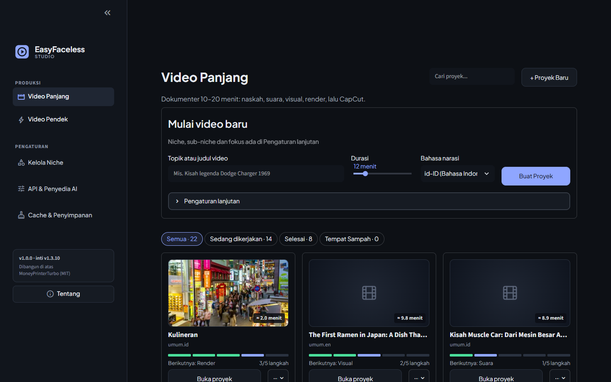
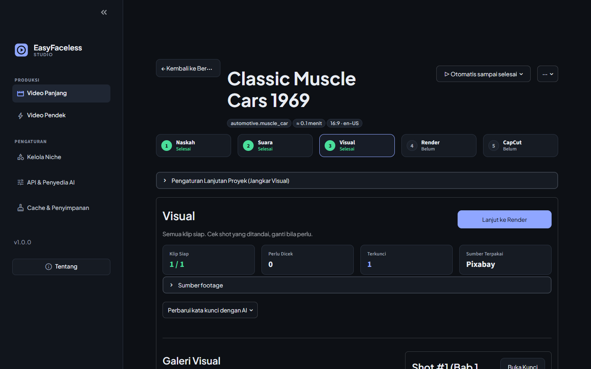
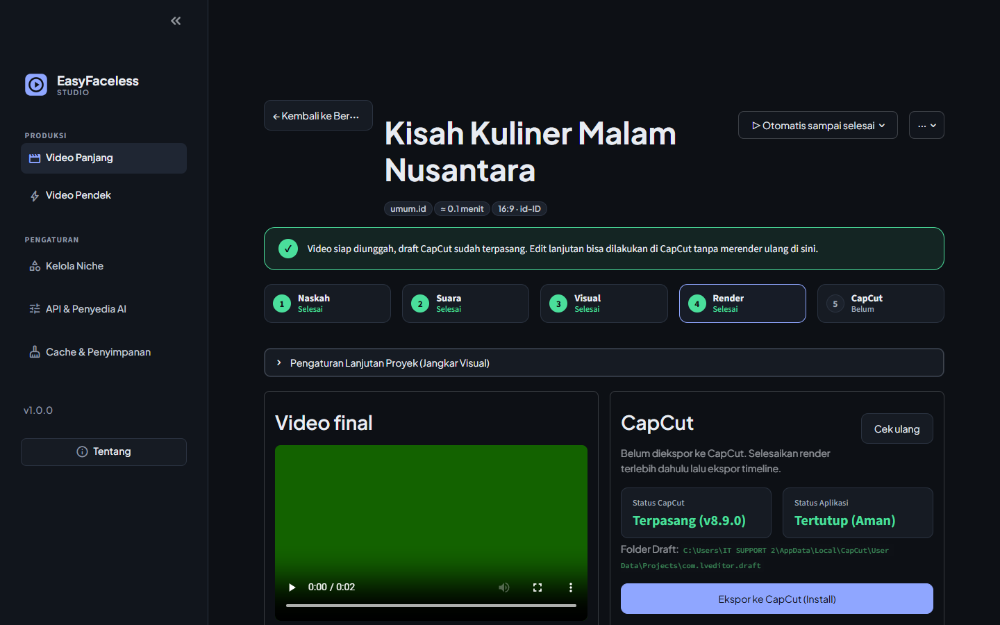
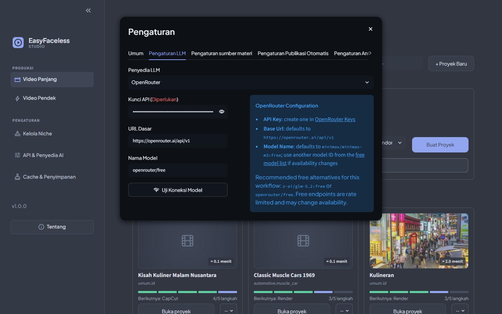

# EasyFaceless Studio

**EasyFaceless Studio** adalah aplikasi desktop berbasis web lokal untuk memproduksi video faceless secara otomatis — mencakup **Video Pendek** cepat maupun **Video Panjang dokumenter (10–20 menit)** lengkap dengan naskah terstruktur, narasi suara, visual multi-shot, render MP4, serta ekspor timeline **CapCut Desktop**.

> Dokumentasi pengguna lengkap tersedia dalam **[Bahasa Indonesia](docs/user/id/README.md)** dan **[English](docs/user/en/README.md)**.

---

## Fitur Utama

- **Video Pendek (Short Video):** Pembuatan video vertikal/horizontal cepat dari topik atau skrip singkat dengan stok footage otomatis, suara AI/Edge TTS, dan subtitle.
- **Video Panjang (Long Video · 10–20 Menit):** Alur kerja 5 tahap berresume aman (**Naskah → Suara → Visual → Render → CapCut**) dengan pelacakan hash inkremental, monitor progres terlingkup, penguncian shot, dan pembaruan sebagian.
- **Ekspor Timeline CapCut Desktop (teruji v8.9.0):** Mengekspor trek video, audio per bab, musik latar, serta subtitle yang selaras hingga tingkat frame dan dapat diedit ulang di CapCut (dilengkapi fitur kalibrasi ukuran teks).
- **Fitur AI Opsional & Terkendali Biaya:** Penulisan naskah per bab dengan penjaga bahasa, pembuat kata kunci visual konkret berbahasa Inggris per shot, cek relevansi footage berbasis *vision* (dengan cache lokal), **Gambar AI**, dan **Video AI** per shot dengan pratinjau estimasi tarif dan batas anggaran wajib.
- **Manajemen Proyek & Tempat Sampah Aman:** Pencarian & filter proyek, preset/sub-niche kustom, dan penghapusan aman ke Tempat Sampah yang dapat dipulihkan.

---

## Pratinjau Antarmuka

| Beranda Video Panjang | Langkah Visual & Galeri Shot |
|---|---|
|  |  |

| Proyek Selesai & Render | Pengaturan Penyedia Terpadu |
|---|---|
|  |  |

---

## Kebutuhan Sistem

- **Sistem Operasi:** Windows 10 / Windows 11 (64-bit)
- **Prosesor (CPU):** Minimal 4 core (disarankan 6–8 core untuk encoding FFmpeg yang lebih cepat)
- **Memori (RAM):** Minimal 8 GB (disarankan 16 GB bila menjalankan CapCut Desktop secara bersamaan)
- **Penyimpanan (Disk):** Minimal 20 GB ruang kosong (SSD disarankan untuk cache footage, audio WAV, dan render sementara)
- **Koneksi Internet:** Diperlukan untuk mencari/mengunduh stok footage, sintesis Edge TTS, dan memanggil penyedia AI eksternal
- **Ketergantungan Sistem:** Python 3.11+, [`uv`](https://docs.astral.sh/uv/), dan `ffmpeg`/`ffprobe` terpasang di `PATH` (atau diatur di Pengaturan)

---

## Menjalankan dari Source (`uv`)

1. **Siapkan dependensi dengan `uv`:**
   ```powershell
   uv sync
   ```
2. **Salin konfigurasi contoh (bila belum ada `config.toml`):**
   ```powershell
   Copy-Item config.example.toml config.toml
   ```
3. **Jalankan WebUI Studio:**
   ```powershell
   uv run streamlit run webui/Main.py
   ```
   Buka browser pada URL lokal yang ditampilkan (umumnya `http://localhost:8501`). Halaman **Video Panjang** dapat diakses langsung melalui menu sidebar.
4. **Penggunaan CLI Video Panjang (opsional):**
   ```powershell
   uv run python cli_longform.py --help
   ```

---

## Struktur Folder Utama

```text
├── app/
│   ├── services/
│   │   ├── branding/       # Identitas studio, sidebar, tema gelap, hooks UI minimal
│   │   ├── longform/       # Mesin & UI Video Panjang (naskah, suara, visual, render, CapCut, trash)
│   │   └── ...             # Layanan inti pembuatan Video Pendek
│   ├── models/             # Skema data inti
│   └── config/             # Loader config.toml & logika konfigurasi
├── config/longform.toml    # Konfigurasi default pipa Video Panjang & tabel estimasi Video AI
├── docs/
│   ├── user/id/            # Panduan pengguna Bahasa Indonesia
│   ├── user/en/            # English user documentation
│   ├── branding/           # Mockup desain & set screenshot final/
│   └── longform/           # Catatan arsitektur & audit pengembangan
├── resource/               # Preset niche bawaan, font subtitle, musik latar, aset merek
├── scripts/                # Skrip utilitas (scripts/dev/ untuk perkakas pengembang)
├── test/                   # Pengujian otomatis Video Pendek & test/longform/
├── webui/                  # Entry point Streamlit (Main.py & pages/1_🎬_Long_Video.py)
├── CHANGELOG.md            # Ringkasan perubahan Tahap 0–8C.1
├── LICENSE                 # Lisensi MIT (Harry & [NAMA PEMILIK])
└── THIRD_PARTY_NOTICES.md  # Daftar lisensi dependensi Python, FFmpeg, font, stok, & layanan eksternal
```

---

## Panduan & Riwayat Perubahan

- **Panduan Pengguna (ID):** [docs/user/id/README.md](docs/user/id/README.md)
- **User Guide (EN):** [docs/user/en/README.md](docs/user/en/README.md)
- **Ringkasan Versi:** [CHANGELOG.md](CHANGELOG.md)
- **Pemberitahuan Pihak Ketiga:** [THIRD_PARTY_NOTICES.md](THIRD_PARTY_NOTICES.md)

---

## Atribusi Upstream (MIT License)

**EasyFaceless Studio** dibangun di atas fondasi **[MoneyPrinterTurbo](https://github.com/harry0703/MoneyPrinterTurbo)** karya Harry (`@harry0703`) di bawah **MIT License**. Fitur inti pembuatan Video Pendek dan dukungan penyedia asli tetap dipertahankan dan dihormati penuh. Lihat [LICENSE](LICENSE) dan [THIRD_PARTY_NOTICES.md](THIRD_PARTY_NOTICES.md) untuk rincian lengkap.
