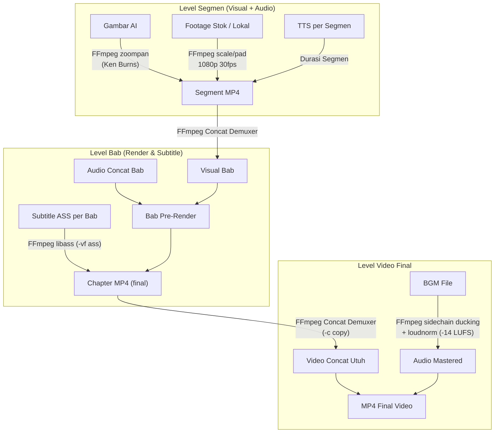

# Usulan Desain Arsitektur Mode Long Video (10–20 Menit)

> [!NOTE]
> Dokumen ini adalah **USULAN DESAIN (PROPOSAL)** untuk Tahap 1–8. Pada Tahap 0 ini, tidak ada kode fitur baru yang diimplementasikan.

---

## 1. Struktur Folder Proyek & Skema Manifest

### 1.1 Struktur Direktori Proyek

Semua proyek long video disimpan terstruktur di bawah `storage/longform_projects/<project_id>/`:

```text
storage/longform_projects/<project_id>/
├── project_manifest.json          # Manifest utama proyek (hierarki bab & segmen)
├── project_state.json             # State progres eksekusi & checkpointing
├── script/
│   ├── outline.json               # Hasil outline LLM (tema, bab, target durasi)
│   └── full_script.json           # Naskah lengkap bertingkat (bab -> segmen)
├── assets/
│   ├── audio/
│   │   ├── chapter_01/
│   │   │   ├── seg_001.mp3        # Audio TTS per segmen
│   │   │   └── chapter_01.mp3     # Audio concat bab
│   │   └── ...
│   ├── subtitles/
│   │   ├── chapter_01.ass         # Subtitle format ASS per bab
│   │   └── full_timeline.ass      # Subtitle gabungan seluruh video
│   ├── visual/
│   │   ├── raw/                   # Gambar AI hasil download, footage stok, file lokal
│   │   └── processed/             # Klip MP4 yang sudah dirender (Ken Burns / scale)
│   └── bgm/
│       ├── raw_bgm.mp3            # File background music
│       └── ducked_bgm.mp3         # BGM yang sudah disesuaikan ducking & loudness
├── chapters/
│   ├── chapter_01.mp4             # Render MP4 Bab 1 (visual + voice + ASS subtitle)
│   ├── chapter_02.mp4             # Render MP4 Bab 2
│   └── ...
├── export/
│   ├── final_video.mp4            # Video utuh hasil concat seluruh bab + BGM
│   ├── youtube_chapters.txt       # Timestamp bab siap salin untuk YouTube deskripsi
│   └── capcut_project/            # Project CapCut yang siap diedit
│       ├── draft_content.json     # Timeline multi-track CapCut
│       └── draft_meta_info.json   # Metadata project CapCut
```

### 1.2 Skema Manifest (`project_manifest.json`)

Manifest menggunakan model Pydantic terstruktur dengan hierarki tiga tingkat: **Project $\rightarrow$ Chapter $\rightarrow$ Segment**.

```json
{
  "version": "1.0",
  "project_id": "proj-uuid-12345",
  "title": "Ancient Wisdom and Modern Psychology",
  "aspect_ratio": "16:9",
  "target_duration_range": [600, 1200],
  "config": {
    "llm_provider": "moonshot",
    "tts_voice": "en-US-ChristopherNeural-Male",
    "tts_rate": 1.0,
    "hardware_acceleration": "auto",
    "target_lufs": -14.0,
    "bgm_ducking_attenuation_db": -16.0
  },
  "chapters": [
    {
      "chapter_index": 1,
      "chapter_title": "The Stoic Mirror: Facing Modern Anxiety",
      "target_word_count": 450,
      "status": "ready_to_render",
      "chapter_hash": "a1b2c3d4...",
      "segments": [
        {
          "segment_index": 1,
          "narration_text": "Throughout ancient history, humans searched for meaning.",
          "visual_cue": {
            "type": "ai_image",
            "prompt": "Ancient Roman philosopher sitting in study at night, cinematic lighting, 4k",
            "motion": "ken_burns_zoom_in",
            "source_path": "assets/visual/raw/img_01_01.png"
          },
          "audio": {
            "duration": 5.42,
            "file_path": "assets/audio/chapter_01/seg_001.mp3",
            "timing_cues": [
              {"start": 0.0, "end": 2.1, "text": "Throughout ancient history,"},
              {"start": 2.1, "end": 5.42, "text": "humans searched for meaning."}
            ]
          },
          "render_hash": "e5f6g7h8..."
        }
      ]
    }
  ]
}
```

---

## 2. Strategi Render Berbasis FFmpeg Native

Seluruh alur render MoviePy upstream ditinggalkan untuk mode long video, digantikan oleh pipeline FFmpeg native yang sangat cepat, ringan memori, dan bebas dari Python GIL bottlenecks:



### 2.1 Efek Ken Burns Native FFmpeg
Mengganti MoviePy CPU lambda resize dengan filter FFmpeg `zoompan`:
```bash
ffmpeg -loop 1 -i image.png -vf "zoompan=z='min(zoom+0.0015,1.2)':d=150:x='iw/2-(iw/zoom/2)':y='ih/2-(ih/zoom/2)':s=1920x1080:fps=30" -t 5 -c:v libx264 -pix_fmt yuv420p output.mp4
```
*Keunggulan*: Dijalankan di level C/multithreaded atau GPU, memakan waktu <0,3 detik per gambar (vs 2,5 detik di MoviePy).

### 2.2 Subtitle ASS via `libass`
- Format ASS mendukung styling kaya (font, warna outline, bayangan, margin, posisi, hingga animasi fade/karaoke).
- Di-burn ke video menggunakan filter FFmpeg: `-vf "ass='path/to/subtitles.ass'"`
- Menghilangkan ratusan objek `TextClip` MoviePy yang selama ini memakan gigabytes RAM.

### 2.3 Audio Ducking & Loudness Normalization
- **Audio Ducking**: Menggunakan filter FFmpeg `sidechaincompress` atau `volume=eval=frame`. Ketika ada suara narasi (voice), volume BGM diturunkan otomatis sebesar -16 dB. Saat jeda antar-kalimat, BGM kembali naik perlahan (*smooth release*).
- **Normalisasi Loudness**: Target standar YouTube adalah **-14 LUFS** dengan true peak max -1 dBTP, dieksekusi via filter FFmpeg `loudnorm=I=-14:TP=-1:LRA=11`.

### 2.4 Akselerasi Hardware Encoder dengan Fallback
- Deteksi ketersediaan hardware encoder saat startup:
  1. NVIDIA NVENC: `h264_nvenc`
  2. AMD AMF: `h264_amf`
  3. Intel QSV: `h264_qsv`
- Jika hardware encoder gagal atau tidak tersedia, fallback otomatis ke encoder software `libx264` (`-c:v libx264 -preset medium -crf 20`).

---

## 3. Strategi Resume & Invalidasi Cache

### 3.1 Hierarki Hash untuk Cache Presisi
Setiap komponen memiliki signature hash SHA-256 yang dihitung dari inputnya:
- `segment_audio_hash`: `sha256(narration_text + voice_name + voice_rate)`
- `segment_visual_hash`: `sha256(visual_source_path + motion_type + duration)`
- `chapter_render_hash`: `sha256(all_segment_hashes_in_chapter + subtitle_styling)`

### 3.2 Alur Resume Cerdas (*Smart Resume*)
Bila pengguna menghentikan proses atau sistem crash di tengah pembuatan video 20 menit:
1. Sistem membaca `project_manifest.json` dan `project_state.json`.
2. Mengecek file fisik `chapters/chapter_01.mp4`, `chapter_02.mp4`, dst.
3. Bila file fisik bab ada dan hash cocok dengan manifest $\rightarrow$ **LEWATI (SKIP)** bab tersebut.
4. **Skenario Edit Naskah**:
   - Jika pengguna mengedit narasi pada **Bab 3**, hanya hash Bab 3 yang berubah.
   - Bab 1, 2, 4, 5, dan 6 **TIDAK dirender ulang**.
   - Sistem hanya merender ulang Bab 3, lalu langsung menjalankan penggabungan akhir (*final concat*) via FFmpeg `-c copy` yang hanya butuh waktu ~5–10 detik!

---

## 4. Pendekatan Export Project CapCut (Desktop)

Selain menghasilkan MP4 final, sistem mengekspor folder draft yang dapat langsung dibuka dan diedit di CapCut Desktop.

### 4.1 Struktur Draft CapCut
Folder project diletakkan di direktori project CapCut Windows:
`%LOCALAPPDATA%\CapCut\User Data\Projects\com.lveditor.draft\<project_name>\`

Dua file utama yang dihasilkan:
1. `draft_meta_info.json`:
   - `draft_name`: Nama proyek
   - `draft_id`: UUID proyek
   - `tm_draft_create`, `tm_draft_modified`: Timestamp mikrodetik
   - `draft_cover`: Gambar cover preview
2. `draft_content.json`:
   - Format timeline multi-track CapCut:
     - Track 1 (Video): Seluruh potongan footage/gambar berurutan sesuai timing segmen.
     - Track 2 (Audio Narasi): Potongan audio suara per segmen.
     - Track 3 (Audio BGM): Lagu latar belakang dengan volume dan fade.
     - Track 4 (Text/Subtitles): Entri teks subtitle dengan properti font, posisi, dan warna.
     - Bagian `materials`: Menghubungkan ID materi dengan path file lokal di disk.

### 4.2 Status Verifikasi vs Dugaan/Hipotesis CapCut

| Aspek / Fitur | Status | Detail Teknis & Bukti |
|:---|:---|:---|
| **Skema JSON Track & Material (`draft_content.json`)** | **TERVERIFIKASI** | Struktur JSON multi-track (video, audio, subtitle) dengan ID materi dan time range telah didokumentasikan dan stabil pada format CapCut v3.x–v4.x. |
| **Path Absolut Windows** | **TERVERIFIKASI** | CapCut membaca file lokal langsung melalui absolute file path Windows yang dideklarasikan di bagian `materials.videos[].path`. |
| **Enkripsi Draft di Versi Terbaru** | **TERVERIFIKASI (RISIKO)** | Pada rilis CapCut Desktop / JianYing Pro versi baru (v5.9+ ke atas), ByteDance menambahkan mekanisme proteksi/enkripsi draft internal untuk draft baru yang dibuat di UI. |
| **Kompatibilitas Backward Draft Tidak Terenkripsi** | **DUGAAN / HIPOTESIS** | CapCut versi baru diduga masih dapat mengimpor draft JSON standar (tidak terenkripsi) jika format header dan version key disetel ke versi kompatibilitas (misal draft version 2/3). Ini akan diuji secara empiris pada Tahap 6. |
| **Mitigasi Format CapCut** | **RENCANA** | Menyediakan opsi export alternatif: (a) Folder Draft CapCut langsung, (b) Format EDL / XML / FCPXML standar industri yang didukung berbagai NLE (Premiere, DaVinci Resolve, CapCut import). |

---

## 5. Daftar Risiko & Mitigasi

| No | Risiko | Tingkat | Dampak | Mitigasi yang Direncanakan |
|:---|:---|:---|:---|:---|
| 1 | **Karakter Path Berspasi di Filter FFmpeg** | Tinggi | FFmpeg error saat mem-burn subtitle ASS (`libass`) karena spasi/titik dua pada path `C:\Users\IT SUPPORT 2\...`. | Menggunakan fungsi utilitas khusus untuk escape path FFmpeg (`_format_ffmpeg_filter_path`), mengubah backslash ke slash dan meng-escape titik dua (`C\:/...`) atau menyalin file ASS sementara ke direktori task relatif. |
| 2 | **Inkonsistensi Durasi Audio TTS** | Sedang | Perbedaan milidetik antara durasi cue kata TTS dan durasi container MP3 menyebabkan visual desinkronisasi. | Mengukur durasi audio riil menggunakan `ffprobe` pada setiap segmen MP3 yang dihasilkan, dan menyelaraskan durasi visual persis dengan hasil ukur riil tersebut. |
| 3 | **Rate Limit / Timeout Provider TTS** | Sedang | Request TTS gagal jika koneksi putus di tengah video panjang. | Sintesis TTS dilakukan per segmen (kalimat pendek ~10–25 kata). Jika segmen ke-25 gagal, hanya segmen ke-25 yang di-retry dengan exponential backoff. Segmen 1–24 tersimpan aman di cache. |
| 4 | **Perubahan Format Draft CapCut** | Sedang | Project tidak bisa dibuka di versi CapCut tertentu akibat enkripsi atau perubahan skema. | Dokumentasikan versi CapCut teruji secara transparan; sediakan template JSON yang kompatibel; siapkan fallback format universal (FCPXML/EDL). |
| 5 | **Beban CPU saat Concat Terlalu Banyak Segmen** | Rendah | Menggabungkan ratusan file parsial membebani IO disk. | Menggabungkan di level segmen $\rightarrow$ bab terlebih dahulu, baru bab $\rightarrow$ video final. Concat demuxer menggunakan `-c copy` (stream copy murni, hanya membutuhkan waktu beberapa detik). |

---

## 6. Daftar Pertanyaan untuk Pengguna (User Review)

Sebelum melangkah ke implementasi tahap berikutnya (Tahap 1), berikut beberapa hal yang memerlukan masukan/konfirmasi dari Anda:

1. **Format Subtitle Long Video**:
   Apakah Anda lebih menyukai tampilan subtitle kalimat penuh (*sentence-level*) yang rapi dan nyaman dibaca untuk video edukasi sejarah/psikologi, atau subtitle dinamis per-kata (*word-by-word highlight/pop*) seperti gaya video pendek/reels?
2. **Preset Ken Burns (Animasi Gambar)**:
   Apakah gerakan Ken Burns acak (*pan left, pan right, zoom in, zoom out*) per segmen sudah sesuai dengan preferensi Anda, atau perlu ada opsi pemilihan gerakan spesifik per bab?
3. **Versi CapCut Desktop Lokal**:
   Versi CapCut Desktop (atau JianYing) berapa yang saat ini terpasang di komputer kerja Anda? (Informasi ini akan membantu kami menargetkan skema versi `draft_content.json` yang paling kompatibel).
4. **Batas Durasi Fleksibel**:
   Apakah rentang default 10–20 menit (600–1.200 detik) dengan batas atas dinamis di `config.toml` sudah sesuai dengan target konten YouTube Anda?
