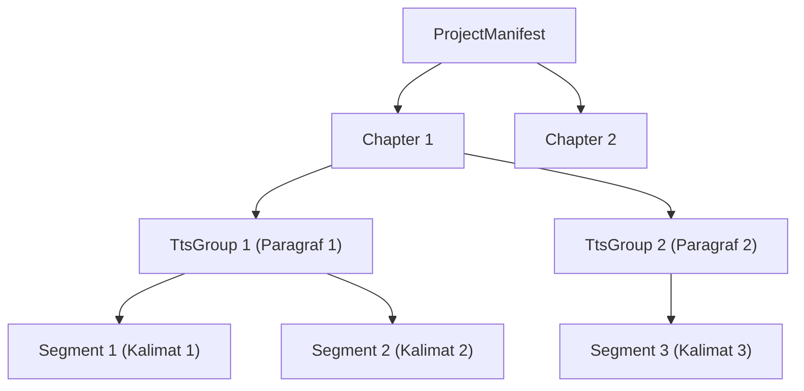

# Usulan Desain Arsitektur Mode Long Video (10–20 Menit)

> [!NOTE]
> Fondasi model data, preset, penyimpanan atomik, hashing, script import, dan planner pada dokumen ini **telah diimplementasikan di Tahap 1**. Pemanggilan TTS, visual, dan render video akan diimplementasikan pada tahap berikutnya (Tahap 2–8).

---

## 1. Filosofi Desain: Niche Bebas Berbasis Preset (Diimplementasikan di Tahap 1)

Fork ini dirancang untuk channel YouTube faceless dengan **NICHE BEBAS** (sejarah, psikologi, sains, misteri, bisnis, biografi, cerita horor, teknologi, dll.). Seluruh karakteristik konten dikendalikan melalui **PRESET** mandiri, **BUKAN** di-hardcode di kode Python maupun di prompt LLM.

---

## 2. Skema PRESET Longform Video (Diimplementasikan di Tahap 1)

Preset disimpan dalam format JSON mandiri. Pengguna dapat menambah preset baru semudah meletakkan file `.json` di folder preset tanpa perlu mengubah kode sumber aplikasi.

### 2.1 Lokasi Penyimpanan & Penemuan (*Discovery*)
1. **Preset Bawaan Sistem**: `resource/presets/*.json`
2. **Preset Pengguna**: `storage/presets/*.json` (diprioritaskan menimpa preset bawaan bila memiliki `id` yang sama).

### 2.2 Spesifikasi Field Skema Preset (Bahasa Inggris K4, Niche & Sub-Niche B1, B4)

| Field | Tipe | Deskripsi & Contoh |
|:---|:---|:---|
| `id` | `str` (slug) | Identifier unik preset (misal: `"automotive"` untuk niche, `"automotive.muscle_car"` untuk sub-niche). |
| `name` | `str` | Nama tampilan di UI/CLI (misal: `"American Muscle Cars"`). |
| `schema_version` | `str` | Versi skema preset (misal: `"1.0.0"`). |
| `kind` | `str` | Jenis tingkatan preset: `"niche"` (induk) atau `"sub_niche"` (anak turunan). |
| `extends` | `str?` | ID preset induk yang diwarisi (opsional, misal: `"automotive"`). |
| `language` | `str` | Kode bahasa narasi (misal: `"en-US"`, `"id-ID"`). |
| `audience` | `str` | Profil audiens target (misal: `"Car enthusiasts, gearheads, YouTube automotive viewers"`). |
| `narration_style` | `str` | Nada & gaya bahasa naskah (misal: `"Punchy, gritty, celebrating raw V8 power and tire smoke"`). |
| `chapter_structure` | `list[str]` | Alur baku bab (misal: `["Hook & Overview", "Origin & Context", "Key Climax", "Legacy"]`). |
| `hook_rules` | `str` | Aturan 15 detik pertama (misal: `"Open with a roaring engine sound description in first 10s"`). |
| `words_per_minute` | `int` | Kecepatan bicara acuan (misal: `145` WPM). |
| `subtitle_style` | `dict` | Styling ASS subtitle: font_name, font_size, bottom_margin, primary_color, outline_color, outline_width. |
| `visual_style` | `str` | Arahan visual utama (misal: `"Cinematic realism, high contrast lighting, mechanical closeups"`). |
| `image_prompt_template` | `dict` | Template prompt AI image: `prefix` dan `suffix`. |
| `visual_source_mix` | `dict[str, float]` | Rasio campuran visual (misal: `{"ai_image": 0.4, "stock_video": 0.6}`). |
| `default_voice` | `str` | Suara TTS bawaan (misal: `"en-US-ChristopherNeural"`). |
| `default_bgm` | `dict` | Kategori BGM, volume bawaan, dan parameter ducking (misal: category `"ambient"`, volume `0.15`, ducking `-16.0dB`). |
| `ken_burns_style` | `str` | Pola animasi gambar bawaan: `"alternating"`, `"zoom_in"`, `"zoom_out"`, `"pan_left"`, `"pan_right"`. |
| `topic_keywords` | `list[str]` | Kata kunci topik utama untuk penulisan naskah dan metadata. |
| `visual_keywords` | `list[str]` | Kata kunci visual khusus untuk pemandu footage/gambar. |
| `sensitivity_notes` | `str` | Panduan kepatuhan/fakta (misal: dilarang mengarang spesifikasi atau angka tanpa rujukan). |
| `recommended_visual_sources` | `dict` | Prioritas urutan sumber footage untuk entitas nyata vs suasana. |

### 2.3 Pewarisan Bertingkat Niche -> Sub-Niche (Addendum 1.5 B1, B2)
- **Aturan Penggabungan (Merge)**:
  - Preset anak (`sub_niche`) mewarisi semua field dari preset induk (`niche`).
  - **Field Nilai Tunggal / Teks**: Nilai di anak menimpa (*override*) nilai di induk.
  - **Field Dictionary**: Digabung secara rekursif per key. Key baru di anak ditambahkan, key yang sama ditimpa.
  - **Field List**:
    - Default: List di anak mengganti (*replace*) seluruh isi list di induk.
    - Penanda Append (`+`): Jika nama key di file JSON diawali tanda `+` (misal `"+topic_keywords": ["hemi", "mopar"]`), elemen list anak akan ditambahkan (*append*) ke ujung list induk.
- **Rantai Pewarisan & Pencegahan Siklus**: Rantai multi-level (A -> B -> C) didukung. Siklus pewarisan dan referensi induk yang hilang ditolak dengan pesan galat eksplisit.
- **Validasi & Snapshot Immutability (K2, B2)**:
  - Menggunakan Pydantic `Preset` dengan pelaporan galat yang menyebutkan nama file dan field bermasalah. Pembacaan file mendukung UTF-8 dan tahan terhadap BOM UTF-8 (`utf-8-sig`).
  - `manifest.json` menyimpan salinan snapshot tergabung (*resolved snapshot*) dan rantai pewarisan saat proyek dibuat.
  - Proyek lama tetap stabil menggunakan snapshot miliknya walau file preset diubah, kecuali jika diperbarui eksplisit via `project refresh-preset`.
  - **Hash Snapshot (K2)**: `preset_snapshot_hash = sha256(canonical_json(preset_snapshot))`.

---

## 3. Struktur Proyek, Satu Sumber Kebenaran & Kunci Proyek (Diimplementasikan di Tahap 1)

### 3.1 Struktur Direktori Proyek

Semua proyek long video disimpan terstruktur di bawah `storage/longform_projects/<project_id>/`:

```text
storage/longform_projects/<project_id>/
├── .lock                          # File lock proyek (PID + timestamp ISO)
├── manifest.json                  # SATU-SATUNYA sumber kebenaran (manifest + state)
├── assets/
│   ├── audio/
│   │   ├── chapter_01/
│   │   │   ├── group_001.mp3      # Audio TTS per TtsGroup (paragraf)
│   │   │   └── chapter_01.mp3     # Audio concat bab
│   │   └── ...
│   ├── visual/
│   │   ├── raw/                   # Gambar AI, stock footage, salinan file lokal (K7)
│   │   └── processed/             # Klip MP4 segmen (hasil Ken Burns / scaling)
│   ├── subtitles/
│   │   ├── chapter_01.ass         # Subtitle ASS per bab untuk burn FFmpeg
│   │   └── full_timeline.ass      # Subtitle utuh seluruh video (tanpa burn)
│   └── bgm/
│       ├── raw_bgm.mp3            # File background music
│       └── ducked_bgm.mp3         # BGM hasil ducking & loudness normalization
├── chapters/
│   ├── chapter_01.mp4             # Render utuh Bab 1 (visual + voice + ASS subtitle)
│   └── ...
└── export/
    ├── final_video.mp4            # Video final (concat seluruh bab + BGM)
    ├── youtube_chapters.txt       # Timestamp bab siap salin untuk YouTube deskripsi
    ├── subtitles/
    │   ├── full_timeline.srt      # Subtitle SRT utuh untuk upload YouTube
    │   └── full_timeline.ass      # Subtitle ASS utuh untuk player eksternal
    └── capcut_project/            # Project CapCut Desktop siap edit
        ├── draft_content.json     # [DUGAAN] Timeline multi-track CapCut
        └── draft_meta_info.json   # [DUGAAN] Metadata project CapCut
```

### 3.2 Satu Sumber Kebenaran, Atomic Write & Project Lock (K5, K7)
- **Satu Sumber Kebenaran**: `manifest.json` adalah satu-satunya penyimpan data dan status proyek.
- **Path Relatif Murni (K7)**: Seluruh path file di dalam manifest WAJIB berupa path relatif terhadap folder proyek (misal: `assets/visual/raw/image_01.png`). Path absolut ditolak saat validasi Pydantic. File visual lokal pengguna selalu disalin ke `assets/visual/raw/`.
- **Penulisan Atomik (K5)**:
  1. Manifest ditulis ke file sementara `manifest.json.tmp.<uuid>`.
  2. Dilakukan `file.flush()` dan `os.fsync(file.fileno())`.
  3. Mengganti file via `os.replace` dengan mekanisme retry hingga 5 kali dengan backoff bertahap (0.05s, 0.1s, 0.2s, 0.4s, 0.8s) untuk mengatasi `PermissionError` sesaat akibat file locking Windows.
- **Lock Proyek (K5)**:
  - File `.lock` dibuat saat proyek dibuka untuk write, berisi baris:
    ```text
    <PID>
    <ISO_8601_TIMESTAMP>
    ```
  - Upaya eksekusi kedua pada proyek yang sama ditolak dengan pesan galat jelas.
  - Bila PID di dalam file `.lock` sudah tidak aktif (*stale lock*), lock secara otomatis diambil alih (*takeover*).

---

## 4. Model Data Bertingkat: Bab -> TTS Group -> Segment (K3)

Untuk menjembatani efisiensi TTS per paragraf dan fleksibilitas visual per kalimat:



1. **Chapter**: Unit render video parsial dan checkpoint resume.
2. **TtsGroup (Paragraf, K3)**: Unit sintesis suara (TTS). Memuat teks seluruh paragraf, audio file, dan `audio_hash`.
3. **Segment (Kalimat, K3)**: Unit pergantian visual (gambar/footage). Memuat teks kalimat, `visual_spec`, `visual_hash`, serta `start_offset_seconds` dan `end_offset_seconds` di dalam audio grupnya.

---

## 5. Formula Hash Cache yang Presisi (K1, K2, K3)

Setiap komponen diverifikasi menggunakan SHA-256 berbasis konten:
1. **Audio Group Hash (K3)**:
   $$\text{Hash}_{\text{audio\_group}} = \text{sha256}(\text{normalized\_paragraph\_text} + "|" + \text{tts\_provider} + "|" + \text{tts\_model} + "|" + \text{voice\_name} + "|" + \text{voice\_rate} + "|" + \text{text\_norm\_version})$$
2. **Visual Segment Hash**:
   $$\text{Hash}_{\text{visual}} = \text{sha256}(\text{source\_file\_content\_hash} + "|" + \text{motion\_type} + "|" + \text{duration} + "|" + \text{target\_w} + "|" + \text{target\_h} + "|" + \text{target\_fps})$$
3. **Chapter Render Hash (K1, K2)**:
   $$\text{Hash}_{\text{chapter}} = \text{sha256}(\text{joined\_ordered\_hashes} + "|" + \text{encoder\_settings\_hash} + "|" + \text{subtitle\_style\_hash} + "|" + \text{preset\_snapshot\_hash} + "|" + \text{pipeline\_version})$$
   - `joined_ordered_hashes`: Gabungan berurutan string hash dari seluruh TtsGroup audio dan Segment visual di bab tersebut dipisahkan karakter delimiter `\n` (bukan penjumlahan numerik).
   - `preset_snapshot_hash`: `sha256(canonical_json(preset_snapshot))`.
   - `pipeline_version`: Disematkan global (misal `"1.0.0"`) agar pembaruan kode render dapat membatalkan cache secara sengaja.

---

## 6. Konfigurasi Long Video Terpisah (K6)

Konfigurasi long video **TIDAK mencemari `config.toml` upstream**.
- Lokasi file: `config/longform.toml` (opsional).
- Default di kode:
  - `min_duration_seconds = 600` (10 menit)
  - `max_duration_seconds = 1200` (20 menit)
- Durasi melebihi `max_duration_seconds` **hanya menampilkan peringatan (warning)**, bukan memblokir pembuatan proyek.

---

## 7. Strategi Render FFmpeg Native & Konsistensi Encoder (Tahap 5)

1. **Konsistensi Encoder**:
   - Encoder (`h264_nvenc`, `h264_amf`, atau fallback `libx264`) dipilih SEKALI saat pembuatan proyek dan dicatat di manifest.
   - Seluruh bab dikunci dengan parameter stream yang identik (`pix_fmt=yuv420p`, `fps=30.0`, `1920x1080`, `aac 44100Hz stereo`).
   - Dilarang mencampur encoder antar-bab. Inspeksi `ffprobe` dijalankan sebelum concat `-c copy`.
2. **Efek Ken Burns**: Filter FFmpeg `zoompan` dengan mitigasi durasi `d = round(duration * fps)` dan smoothing trajectory untuk mencegah jitter.
3. **Subtitle ASS & Subtitle Bersih**: Burn subtitle per bab via `libass`; simpan file unburned di `export/subtitles/`.
4. **BGM Ducking & Loudness**: `sidechaincompress` ducking BGM saat narasi aktif + normalisasi `-14 LUFS` via filter `loudnorm`.

---

## 8. Abstraksi Sumber Gambar AI & Export CapCut (Tahap 4 & 6)

1. **Abstraksi Gambar AI**: Interface `BaseImageProvider.generate(prompt, size, seed)` disiapkan agar provider baru dapat ditambah tanpa mengubah kode inti.
2. **Export CapCut**: Format draft `draft_content.json` ditargetkan untuk CapCut Desktop 8.9.0 Windows [DUGAAN], diverifikasi langsung di Tahap 6.

---

## 9. Keputusan Desain yang Telah Disepakati

1. **Subtitle**: Diatur per preset. Default = kalimat/frasa penuh (maks 2 baris) di bawah layar; mode per-kata tersedia via preset.
2. **Ken Burns**: Default bergantian otomatis (*alternating*); field opsional di segmen untuk mengunci tipe animasi (`zoom_in`, `zoom_out`, `pan_left`, `pan_right`, `static`).
3. **Batas Durasi**: Default `min_seconds = 600`, `max_seconds = 1200` (peringatan bila melampaui).
4. **CapCut Desktop**: Versi terpasang pengguna adalah **8.9.0 (Windows)**, diverifikasi empiris di Tahap 6.
